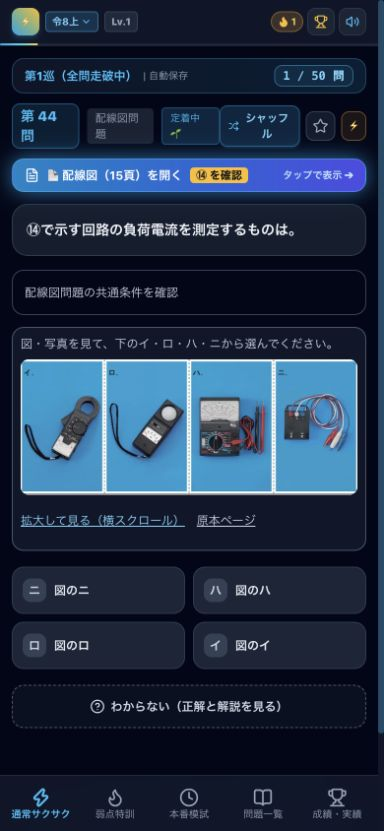

# 過去5回・250問の学習テキスト点検（2026-10-14）

対象：令和6年度上期・下期、令和7年度上期・下期、令和8年度上期。基準コミット：46c4a2e（前回点検の反映後）。元データと共有修正を合成した公開用データを対象に、問題文・四肢・正答・解説・要点を点検した。

## 結果

- 250問の正答を試験センターの各回の公式解答と照合し、250問すべて一致。今回、正答の記号は変更していない。
- 121問にテキスト修正（単位表記・表の列数修正を含む）。問題文35問、選択肢64問、解説30問、要点26問。各項目は重複するため合計は問題数と一致しない。
- 62問の図・写真選択肢を原本の画像へ変更。器具名や図の意味を先に答えていたテキストは「図のイ」等へ変更。画像のaltにも名称や正答を入れない。
- 早見表16種を点検。資格要否、幹線電流の条件、分岐遮断器の距離、リングスリーブ大の出題、測定方法などを修正。関連しない早見表への番号対応も整理。
- 問題一覧の要点プレビュー、模試の詳細分野タグを解答前に表示しない。解説の一行表が消える不具合を修正。新規利用時の自動送りはオフ（保存済み設定は保持）。合格や記憶定着を断定する文言を改めた。

## 代表例

| 対象 | 問題 | 修正 |
|---|---|---|
| 令和7年度下期 問38 | 問題文に正解となる器具の名称が追記されていた | 原本にない補足を削除 |
| 令和6年度下期 問24 | メーターの読み取り値が問題文の補足に入っていた | 写真から読み取る出題に戻す |
| 令和7年度下期 問24 | 選択肢の空欄Aの内容が原本と異なった | ロ・ハ・ニを原本に合わせる |
| 令和8年度上期 問3 | 一行だけの表が画面から消えていた | 300×7200＝2160000 J＝2160 kJの計算を明示 |
| 令和8年度上期 問7 | スイッチ操作後の電流変化を省略 | 105÷3.4から再計算し、上昇約3 Vを説明 |
| 令和8年度上期 問35 | 正解の図記号と解説の名称が不整合 | ハの引掛シーリングとして説明 |
| 資格の早見表 | 配電盤・ボックスの固定は資格不要としていた | 要資格の作業と、軽微な工事・軽微な作業を区別 |
| スリーブの早見表 | 大は出題されないとしていた | 令和6年度下期 問42の出題を含めて修正 |

## 確認方法と限界

- 全250問を読み、解答前の手掛かり、選択肢との整合、計算・数値条件、解説と要点の食い違いを点検。公式問題PDF・公式解答PDF、必要な法令資料・工具メーカー資料を参照した。
- 原本の選択肢画像62枚を一覧で目視確認し、イ・ロ・ハ・ニ、数値・刻印・接点図が欠けないよう調整。
- `npm test`：250問の公式解答、通常出題250画面＋模試250画面の解説・要点・詳細タグ非表示、解説表示、画像62枚の存在、表の列数、早見表ID、保存済み設定、一行解説を確認。
- `npm run build`：成功。大きなJSファイルに関する既存の警告は残る。
- ブラウザー：390×844、844×390、1280×800で表示確認。問題一覧、通常出題での写真表示・拡大・解答後の解説、自動送りオフ、模試での写真出題を確認。
- 自動検証は教材の意味を証明するものではない。専門家の第三者校閲や合格率の実測は行っていない。利用者が端末内に保存した独自修正は保持され、公開用データより優先される場合がある。

## 出典

- [電気技術者試験センター：第二種電気工事士・過去問題と解答](https://www.shiken.or.jp/construction/second/qa/)。各回の問題・解答を使用。
- [経済産業省：電気工事士等資格不要の軽微な工事](https://www.meti.go.jp/policy/safety_security/industrial_safety/sangyo/electric/files/1-3keibi.pdf)
- [経済産業省：電気設備の技術基準の解釈](https://www.meti.go.jp/policy/safety_security/industrial_safety/sangyo/electric/files/20231226-2.pdf)
- [経済産業省：技術基準の解釈の解説](https://www.meti.go.jp/policy/safety_security/industrial_safety/sangyo/electric/files/20220331-4.pdf)
- [HOZAN：リングスリーブ用圧着工具P-738適合表](https://www.hozan.co.jp/download/manual/P-738.pdf)

法令の説明は収録過去問の出題条件に合わせた学習用整理。将来の試験向けに法改正を自動追従するものではない。

## 全250問の点検記録

「変更なし」も点検対象。正答は全行で公式一致。機械判読用の記録と本文ハッシュは `learning-text-2026-10-14.json`、正答照合用は `official-answers.json`。

| 回 | 問 | 今回変更した項目 | 点検結果・理由 |
|---|---:|---|---|
| r6_1 | 1 | 変更なし | 点検済み・本文変更なし |
| r6_1 | 2 | 変更なし | 点検済み・本文変更なし |
| r6_1 | 3 | 変更なし | 点検済み・本文変更なし |
| r6_1 | 4 | 変更なし | 点検済み・本文変更なし |
| r6_1 | 5 | 変更なし | 点検済み・本文変更なし |
| r6_1 | 6 | 変更なし | 点検済み・本文変更なし |
| r6_1 | 7 | 変更なし | 点検済み・本文変更なし |
| r6_1 | 8 | 解説 | 原本の数値選択肢の指示に統一／解説表の列数を整合 |
| r6_1 | 9 | 要点 | 電動機が他の負荷より大きい条件を補足／解説表の列数を整合 |
| r6_1 | 10 | 変更なし | 点検済み・本文変更なし |
| r6_1 | 11 | 変更なし | 点検済み・本文変更なし |
| r6_1 | 12 | 変更なし | 点検済み・本文変更なし |
| r6_1 | 13 | 変更なし | 点検済み・本文変更なし |
| r6_1 | 14 | 変更なし | 点検済み・本文変更なし |
| r6_1 | 15 | 変更なし | 点検済み・本文変更なし |
| r6_1 | 16 | 変更なし | 点検済み・本文変更なし |
| r6_1 | 17 | 変更なし | 点検済み・本文変更なし |
| r6_1 | 18 | 解説 | 解説表の列数を整合 |
| r6_1 | 19 | 変更なし | 点検済み・本文変更なし |
| r6_1 | 20 | 要点 | 金属ダクトまで貫通禁止とする誤った一般化を修正／解説表の列数を整合 |
| r6_1 | 21 | 解説・要点 | 1種の使用場所と2種の防湿条件を修正 |
| r6_1 | 22 | 変更なし | 点検済み・本文変更なし |
| r6_1 | 23 | 変更なし | 点検済み・本文変更なし |
| r6_1 | 24 | 変更なし | 点検済み・本文変更なし |
| r6_1 | 25 | 変更なし | 点検済み・本文変更なし |
| r6_1 | 26 | 変更なし | 点検済み・本文変更なし |
| r6_1 | 27 | 解説・要点 | 交流記号だけで計器の動作原理を断定しない |
| r6_1 | 28 | 解説 | 資格要否の理由と軽微な工事／作業の区別を補足／解説表の列数を整合 |
| r6_1 | 29 | 変更なし | 点検済み・本文変更なし |
| r6_1 | 30 | 解説 | 電線の定義の不正確な引用を修正／解説表の列数を整合 |
| r6_1 | 31 | 変更なし | 点検済み・本文変更なし |
| r6_1 | 32 | 変更なし | 点検済み・本文変更なし |
| r6_1 | 33 | 選択肢 | 図・写真選択肢を原本画像に戻し、鑑別結果の先出しを解消 |
| r6_1 | 34 | 変更なし | 点検済み・本文変更なし |
| r6_1 | 35 | 変更なし | 点検済み・本文変更なし |
| r6_1 | 36 | 変更なし | 点検済み・本文変更なし |
| r6_1 | 37 | 選択肢 | 図・写真選択肢を原本画像に戻し、鑑別結果の先出しを解消 |
| r6_1 | 38 | 変更なし | 点検済み・本文変更なし |
| r6_1 | 39 | 変更なし | 点検済み・本文変更なし |
| r6_1 | 40 | 変更なし | 点検済み・本文変更なし |
| r6_1 | 41 | 選択肢 | 図・写真選択肢を原本画像に戻し、鑑別結果の先出しを解消／解説表の列数を整合 |
| r6_1 | 42 | 問題文・選択肢 | 原本にない図・写真の読み取り補足を削除／図・写真選択肢を原本画像に戻し、鑑別結果の先出しを解消 |
| r6_1 | 43 | 選択肢 | 図・写真選択肢を原本画像に戻し、鑑別結果の先出しを解消／解説表の列数を整合 |
| r6_1 | 44 | 選択肢 | 図・写真選択肢を原本画像に戻し、鑑別結果の先出しを解消 |
| r6_1 | 45 | 選択肢 | 図・写真選択肢を原本画像に戻し、鑑別結果の先出しを解消 |
| r6_1 | 46 | 選択肢・解説 | 図・写真選択肢を原本画像に戻し、鑑別結果の先出しを解消／不確かな規格番号を除き工具と用途に集中 |
| r6_1 | 47 | 選択肢 | 図・写真選択肢を原本画像に戻し、鑑別結果の先出しを解消 |
| r6_1 | 48 | 選択肢・要点 | 図・写真選択肢を原本画像に戻し、鑑別結果の先出しを解消／中スリーブの上限のない一般化を修正／解説表の列数を整合 |
| r6_1 | 49 | 選択肢 | 図・写真選択肢を原本画像に戻し、鑑別結果の先出しを解消／解説表の列数を整合 |
| r6_1 | 50 | 選択肢 | 図・写真選択肢を原本画像に戻し、鑑別結果の先出しを解消／解説表の列数を整合 |
| r6_2 | 1 | 変更なし | 点検済み・本文変更なし |
| r6_2 | 2 | 変更なし | 点検済み・本文変更なし |
| r6_2 | 3 | 変更なし | 点検済み・本文変更なし |
| r6_2 | 4 | 選択肢 | 図・写真選択肢を原本画像に戻し、鑑別結果の先出しを解消 |
| r6_2 | 5 | 変更なし | 点検済み・本文変更なし |
| r6_2 | 6 | 変更なし | 点検済み・本文変更なし |
| r6_2 | 7 | 変更なし | 点検済み・本文変更なし |
| r6_2 | 8 | 解説 | 原本の数値選択肢の指示に統一／解説表の列数を整合 |
| r6_2 | 9 | 解説・要点 | 3m以下でも電線の太さが無制限にはならない |
| r6_2 | 10 | 変更なし | 点検済み・本文変更なし |
| r6_2 | 11 | 変更なし | 点検済み・本文変更なし |
| r6_2 | 12 | 変更なし | 点検済み・本文変更なし |
| r6_2 | 13 | 変更なし | 点検済み・本文変更なし |
| r6_2 | 14 | 変更なし | 点検済み・本文変更なし |
| r6_2 | 15 | 変更なし | 点検済み・本文変更なし |
| r6_2 | 16 | 変更なし | 点検済み・本文変更なし |
| r6_2 | 17 | 問題文 | 写真で特定する対象を原本に合わせる |
| r6_2 | 18 | 問題文 | 原本にない図・写真の読み取り補足を削除 |
| r6_2 | 19 | 変更なし | 点検済み・本文変更なし |
| r6_2 | 20 | 変更なし | 点検済み・本文変更なし |
| r6_2 | 21 | 要点 | 例外規定の2kW以上・直接接続条件を明記／解説表の列数を整合 |
| r6_2 | 22 | 変更なし | 点検済み・本文変更なし |
| r6_2 | 23 | 変更なし | 点検済み・本文変更なし |
| r6_2 | 24 | 問題文 | 原本にない図・写真の読み取り補足を削除／解説表の列数を整合 |
| r6_2 | 25 | 変更なし | 点検済み・本文変更なし |
| r6_2 | 26 | 変更なし | 点検済み・本文変更なし |
| r6_2 | 27 | 選択肢 | 図・写真選択肢を原本画像に戻し、鑑別結果の先出しを解消 |
| r6_2 | 28 | 解説 | 資格要否の理由と軽微な工事／作業の区別を補足／解説表の列数を整合 |
| r6_2 | 29 | 解説 | 解説表の列数を整合 |
| r6_2 | 30 | 変更なし | 点検済み・本文変更なし |
| r6_2 | 31 | 変更なし | 点検済み・本文変更なし |
| r6_2 | 32 | 要点 | 15mだけで無条件に省略可能としない／解説表の列数を整合 |
| r6_2 | 33 | 問題文 | 原本にない図・写真の読み取り補足を削除 |
| r6_2 | 34 | 問題文 | 原本にない図・写真の読み取り補足を削除 |
| r6_2 | 35 | 問題文 | 原本にない図・写真の読み取り補足を削除 |
| r6_2 | 36 | 変更なし | 点検済み・本文変更なし |
| r6_2 | 37 | 変更なし | 点検済み・本文変更なし |
| r6_2 | 38 | 問題文 | 原本にない図・写真の読み取り補足を削除／解説表の列数を整合 |
| r6_2 | 39 | 問題文・選択肢 | 原本にない図・写真の読み取り補足を削除／図・写真選択肢を原本画像に戻し、鑑別結果の先出しを解消／解説表の列数を整合 |
| r6_2 | 40 | 選択肢 | 図・写真選択肢を原本画像に戻し、鑑別結果の先出しを解消 |
| r6_2 | 41 | 選択肢 | 図・写真選択肢を原本画像に戻し、鑑別結果の先出しを解消 |
| r6_2 | 42 | 選択肢 | 図・写真選択肢を原本画像に戻し、鑑別結果の先出しを解消／解説表の列数を整合 |
| r6_2 | 43 | 選択肢 | 図・写真選択肢を原本画像に戻し、鑑別結果の先出しを解消／解説表の列数を整合 |
| r6_2 | 44 | 選択肢・要点 | 図・写真選択肢を原本画像に戻し、鑑別結果の先出しを解消／露出ボックスを屋外・防雨と断定しない／解説表の列数を整合 |
| r6_2 | 45 | 問題文・選択肢 | 原本にない図・写真の読み取り補足を削除／図・写真選択肢を原本画像に戻し、鑑別結果の先出しを解消／解説表の列数を整合 |
| r6_2 | 46 | 選択肢・要点 | 図・写真選択肢を原本画像に戻し、鑑別結果の先出しを解消／電灯回路なら必ずVVFとする一般化を修正／解説表の列数を整合 |
| r6_2 | 47 | 問題文・選択肢 | 原本にない用途補足を削除／図・写真選択肢を原本画像に戻し、鑑別結果の先出しを解消 |
| r6_2 | 48 | 問題文・選択肢 | 原本にない図・写真の読み取り補足を削除／図・写真選択肢を原本画像に戻し、鑑別結果の先出しを解消 |
| r6_2 | 49 | 選択肢 | 図・写真選択肢を原本画像に戻し、鑑別結果の先出しを解消／解説表の列数を整合 |
| r6_2 | 50 | 問題文・選択肢 | 原本にない図・写真の読み取り補足を削除／図・写真選択肢を原本画像に戻し、鑑別結果の先出しを解消 |
| r7_1 | 1 | 変更なし | 点検済み・本文変更なし |
| r7_1 | 2 | 変更なし | 点検済み・本文変更なし |
| r7_1 | 3 | 変更なし | 点検済み・本文変更なし |
| r7_1 | 4 | 変更なし | 点検済み・本文変更なし |
| r7_1 | 5 | 変更なし | 点検済み・本文変更なし |
| r7_1 | 6 | 変更なし | 点検済み・本文変更なし |
| r7_1 | 7 | 変更なし | 点検済み・本文変更なし |
| r7_1 | 8 | 解説 | 原本の数値選択肢の指示に統一／解説表の列数を整合 |
| r7_1 | 9 | 解説・要点 | 3m以下でも電線の太さが無制限にはならない／解説表の列数を整合 |
| r7_1 | 10 | 変更なし | 点検済み・本文変更なし |
| r7_1 | 11 | 変更なし | 点検済み・本文変更なし |
| r7_1 | 12 | 変更なし | 点検済み・本文変更なし |
| r7_1 | 13 | 変更なし | 点検済み・本文変更なし |
| r7_1 | 14 | 変更なし | 点検済み・本文変更なし |
| r7_1 | 15 | 要点 | ランプと安定器は適合製品を組み合わせる／解説表の列数を整合 |
| r7_1 | 16 | 変更なし | 点検済み・本文変更なし |
| r7_1 | 17 | 変更なし | 点検済み・本文変更なし |
| r7_1 | 18 | 変更なし | 点検済み・本文変更なし |
| r7_1 | 19 | 解説・要点 | 20%ちょうどを禁止する要点の不整合を修正／解説表の列数を整合 |
| r7_1 | 20 | 変更なし | 点検済み・本文変更なし |
| r7_1 | 21 | 解説・要点 | 2kW未満なら直接接続不要と読める説明を修正 |
| r7_1 | 22 | 変更なし | 点検済み・本文変更なし |
| r7_1 | 23 | 変更なし | 点検済み・本文変更なし |
| r7_1 | 24 | 変更なし | 点検済み・本文変更なし |
| r7_1 | 25 | 選択肢 | 図・写真選択肢を原本画像に戻し、鑑別結果の先出しを解消 |
| r7_1 | 26 | 解説 | 解説表の列数を整合 |
| r7_1 | 27 | 問題文 | 計器の構造を先に説明しない／解説表の列数を整合 |
| r7_1 | 28 | 変更なし | 点検済み・本文変更なし |
| r7_1 | 29 | 解説 | 解説表の列数を整合 |
| r7_1 | 30 | 解説・要点 | 発電設備の容量だけで一般用と断定しない |
| r7_1 | 31 | 変更なし | 点検済み・本文変更なし |
| r7_1 | 32 | 変更なし | 点検済み・本文変更なし |
| r7_1 | 33 | 問題文 | 原本にない図・写真の読み取り補足を削除／解説表の列数を整合 |
| r7_1 | 34 | 変更なし | 点検済み・本文変更なし |
| r7_1 | 35 | 変更なし | 点検済み・本文変更なし |
| r7_1 | 36 | 変更なし | 点検済み・本文変更なし |
| r7_1 | 37 | 変更なし | 点検済み・本文変更なし |
| r7_1 | 38 | 変更なし | 点検済み・本文変更なし |
| r7_1 | 39 | 変更なし | 点検済み・本文変更なし |
| r7_1 | 40 | 変更なし | 点検済み・本文変更なし |
| r7_1 | 41 | 問題文・選択肢 | 原本にない図・写真の読み取り補足を削除／図・写真選択肢を原本画像に戻し、鑑別結果の先出しを解消／解説表の列数を整合 |
| r7_1 | 42 | 選択肢 | 図・写真選択肢を原本画像に戻し、鑑別結果の先出しを解消／解説表の列数を整合 |
| r7_1 | 43 | 選択肢 | 図・写真選択肢を原本画像に戻し、鑑別結果の先出しを解消／解説表の列数を整合 |
| r7_1 | 44 | 選択肢 | 図・写真選択肢を原本画像に戻し、鑑別結果の先出しを解消／解説表の列数を整合 |
| r7_1 | 45 | 選択肢 | 図・写真選択肢を原本画像に戻し、鑑別結果の先出しを解消／解説表の列数を整合 |
| r7_1 | 46 | 選択肢 | 図・写真選択肢を原本画像に戻し、鑑別結果の先出しを解消／解説表の列数を整合 |
| r7_1 | 47 | 選択肢 | 図・写真選択肢を原本画像に戻し、鑑別結果の先出しを解消／解説表の列数を整合 |
| r7_1 | 48 | 選択肢 | 図・写真選択肢を原本画像に戻し、鑑別結果の先出しを解消／解説表の列数を整合 |
| r7_1 | 49 | 選択肢 | 図・写真選択肢を原本画像に戻し、鑑別結果の先出しを解消 |
| r7_1 | 50 | 選択肢 | 図・写真選択肢を原本画像に戻し、鑑別結果の先出しを解消／解説表の列数を整合 |
| r7_2 | 1 | 変更なし | 点検済み・本文変更なし |
| r7_2 | 2 | 変更なし | 点検済み・本文変更なし |
| r7_2 | 3 | 変更なし | 点検済み・本文変更なし |
| r7_2 | 4 | 問題文・選択肢 | 原本にない図・写真の読み取り補足を削除／図・写真選択肢を原本画像に戻し、鑑別結果の先出しを解消 |
| r7_2 | 5 | 変更なし | 点検済み・本文変更なし |
| r7_2 | 6 | 変更なし | 点検済み・本文変更なし |
| r7_2 | 7 | 変更なし | 点検済み・本文変更なし |
| r7_2 | 8 | 解説 | 原本の数値選択肢の指示に統一／解説表の列数を整合 |
| r7_2 | 9 | 解説・要点 | 3m以下でも電線の太さが無制限にはならない／解説表の列数を整合 |
| r7_2 | 10 | 変更なし | 点検済み・本文変更なし |
| r7_2 | 11 | 変更なし | 点検済み・本文変更なし |
| r7_2 | 12 | 変更なし | 点検済み・本文変更なし |
| r7_2 | 13 | 問題文 | 原本にない図・写真の読み取り補足を削除 |
| r7_2 | 14 | 変更なし | 点検済み・本文変更なし |
| r7_2 | 15 | 変更なし | 点検済み・本文変更なし |
| r7_2 | 16 | 問題文・解説 | 原本にない図・写真の読み取り補足を削除／解説表の列数を整合 |
| r7_2 | 17 | 問題文 | 原本にない図・写真の読み取り補足を削除 |
| r7_2 | 18 | 問題文 | 原本にない図・写真の読み取り補足を削除 |
| r7_2 | 19 | 変更なし | 点検済み・本文変更なし |
| r7_2 | 20 | 変更なし | 点検済み・本文変更なし |
| r7_2 | 21 | 変更なし | 点検済み・本文変更なし |
| r7_2 | 22 | 解説・要点 | 30mAでは15mAの接地省略条件を満たさない理由を補足 |
| r7_2 | 23 | 選択肢 | 図・写真選択肢を原本画像に戻し、鑑別結果の先出しを解消 |
| r7_2 | 24 | 選択肢 | 原本のロ・ハの空欄Aを復元／解説表の列数を整合 |
| r7_2 | 25 | 変更なし | 点検済み・本文変更なし |
| r7_2 | 26 | 変更なし | 点検済み・本文変更なし |
| r7_2 | 27 | 問題文 | 計器の構造を先に説明しない／解説表の列数を整合 |
| r7_2 | 28 | 解説 | 解説表の列数を整合 |
| r7_2 | 29 | 変更なし | 点検済み・本文変更なし |
| r7_2 | 30 | 変更なし | 点検済み・本文変更なし |
| r7_2 | 31 | 問題文・解説 | 原本にない図・写真の読み取り補足を削除／解説表の列数を整合 |
| r7_2 | 32 | 問題文・選択肢 | 原本にない図・写真の読み取り補足を削除／選択肢に後付けされた記号対応を削除／解説表の列数を整合 |
| r7_2 | 33 | 問題文 | 原本にない図・写真の読み取り補足を削除／解説表の列数を整合 |
| r7_2 | 34 | 変更なし | 点検済み・本文変更なし |
| r7_2 | 35 | 問題文 | 原本にない図・写真の読み取り補足を削除／解説表の列数を整合 |
| r7_2 | 36 | 問題文 | 原本にない図・写真の読み取り補足を削除／解説表の列数を整合 |
| r7_2 | 37 | 問題文 | 原本にない図・写真の読み取り補足を削除／解説表の列数を整合 |
| r7_2 | 38 | 問題文 | 原本にない図・写真の読み取り補足を削除／解説表の列数を整合 |
| r7_2 | 39 | 問題文 | 原本にない図・写真の読み取り補足を削除／解説表の列数を整合 |
| r7_2 | 40 | 問題文 | 原本にない図・写真の読み取り補足を削除 |
| r7_2 | 41 | 選択肢 | 図・写真選択肢を原本画像に戻し、鑑別結果の先出しを解消／解説表の列数を整合 |
| r7_2 | 42 | 選択肢 | 図・写真選択肢を原本画像に戻し、鑑別結果の先出しを解消 |
| r7_2 | 43 | 問題文・選択肢 | 原本にない図・写真の読み取り補足を削除／図・写真選択肢を原本画像に戻し、鑑別結果の先出しを解消 |
| r7_2 | 44 | 問題文・選択肢 | 原本にない図・写真の読み取り補足を削除／図・写真選択肢を原本画像に戻し、鑑別結果の先出しを解消 |
| r7_2 | 45 | 選択肢 | 図・写真選択肢を原本画像に戻し、鑑別結果の先出しを解消／解説表の列数を整合 |
| r7_2 | 46 | 選択肢 | 図・写真選択肢を原本画像に戻し、鑑別結果の先出しを解消／解説表の列数を整合 |
| r7_2 | 47 | 選択肢 | 図・写真選択肢を原本画像に戻し、鑑別結果の先出しを解消／解説表の列数を整合 |
| r7_2 | 48 | 選択肢 | 図・写真選択肢を原本画像に戻し、鑑別結果の先出しを解消 |
| r7_2 | 49 | 選択肢 | 図・写真選択肢を原本画像に戻し、鑑別結果の先出しを解消／解説表の列数を整合 |
| r7_2 | 50 | 選択肢 | 図・写真選択肢を原本画像に戻し、鑑別結果の先出しを解消 |
| r8_1 | 1 | 変更なし | 点検済み・本文変更なし |
| r8_1 | 2 | 変更なし | 点検済み・本文変更なし |
| r8_1 | 3 | 解説 | 表示されない1行表を解法の完結した文章に修正 |
| r8_1 | 4 | 変更なし | 点検済み・本文変更なし |
| r8_1 | 5 | 変更なし | 点検済み・本文変更なし |
| r8_1 | 6 | 変更なし | 点検済み・本文変更なし |
| r8_1 | 7 | 解説・要点 | 負荷抵抗一定時の電流変化も含めて計算 |
| r8_1 | 8 | 問題文・解説・要点 | 原本の数値選択肢の指示に統一／面積単位をmm²に統一／面積単位をmm²に統一／解説表の列数を整合 |
| r8_1 | 9 | 変更なし | 点検済み・本文変更なし |
| r8_1 | 10 | 変更なし | 点検済み・本文変更なし |
| r8_1 | 11 | 変更なし | 点検済み・本文変更なし |
| r8_1 | 12 | 問題文・要点 | 面積単位をmm²に統一／面積単位をmm²に統一 |
| r8_1 | 13 | 変更なし | 点検済み・本文変更なし |
| r8_1 | 14 | 変更なし | 点検済み・本文変更なし |
| r8_1 | 15 | 変更なし | 点検済み・本文変更なし |
| r8_1 | 16 | 変更なし | 点検済み・本文変更なし |
| r8_1 | 17 | 変更なし | 点検済み・本文変更なし |
| r8_1 | 18 | 変更なし | 点検済み・本文変更なし |
| r8_1 | 19 | 変更なし | 点検済み・本文変更なし |
| r8_1 | 20 | 要点 | 垂直6mの接触防護条件を要点にも明記／解説表の列数を整合 |
| r8_1 | 21 | 要点 | 木造住宅全体への一律禁止としない／解説表の列数を整合 |
| r8_1 | 22 | 解説・要点 | 湿気と水気を区別し他の選択肢も説明 |
| r8_1 | 23 | 変更なし | 点検済み・本文変更なし |
| r8_1 | 24 | 変更なし | 点検済み・本文変更なし |
| r8_1 | 25 | 変更なし | 点検済み・本文変更なし |
| r8_1 | 26 | 変更なし | 点検済み・本文変更なし |
| r8_1 | 27 | 選択肢 | 図・写真選択肢を原本画像に戻し、鑑別結果の先出しを解消／解説表の列数を整合 |
| r8_1 | 28 | 解説 | 資格要否の理由と軽微な工事／作業の区別を補足／解説表の列数を整合 |
| r8_1 | 29 | 変更なし | 点検済み・本文変更なし |
| r8_1 | 30 | 変更なし | 点検済み・本文変更なし |
| r8_1 | 31 | 変更なし | 点検済み・本文変更なし |
| r8_1 | 32 | 要点 | 問題の5本と矛盾する白黒2本の定型説明を修正／解説表の列数を整合 |
| r8_1 | 33 | 変更なし | 点検済み・本文変更なし |
| r8_1 | 34 | 変更なし | 点検済み・本文変更なし |
| r8_1 | 35 | 選択肢・解説 | 図・写真選択肢を原本画像に戻し、鑑別結果の先出しを解消／実際の選択肢ハの記号を解説に復元 |
| r8_1 | 36 | 変更なし | 点検済み・本文変更なし |
| r8_1 | 37 | 選択肢 | 図・写真選択肢を原本画像に戻し、鑑別結果の先出しを解消／解説表の列数を整合 |
| r8_1 | 38 | 変更なし | 点検済み・本文変更なし |
| r8_1 | 39 | 変更なし | 点検済み・本文変更なし |
| r8_1 | 40 | 変更なし | 点検済み・本文変更なし |
| r8_1 | 41 | 選択肢・要点 | 図・写真選択肢を原本画像に戻し、鑑別結果の先出しを解消／中スリーブの上限のない一般化を修正／解説表の列数を整合 |
| r8_1 | 42 | 選択肢 | 図・写真選択肢を原本画像に戻し、鑑別結果の先出しを解消／解説表の列数を整合 |
| r8_1 | 43 | 選択肢 | 図・写真選択肢を原本画像に戻し、鑑別結果の先出しを解消 |
| r8_1 | 44 | 選択肢 | 図・写真選択肢を原本画像に戻し、鑑別結果の先出しを解消 |
| r8_1 | 45 | 選択肢 | 図・写真選択肢を原本画像に戻し、鑑別結果の先出しを解消／解説表の列数を整合 |
| r8_1 | 46 | 選択肢 | 図・写真選択肢を原本画像に戻し、鑑別結果の先出しを解消／解説表の列数を整合 |
| r8_1 | 47 | 選択肢 | 図・写真選択肢を原本画像に戻し、鑑別結果の先出しを解消／解説表の列数を整合 |
| r8_1 | 48 | 選択肢 | 図・写真選択肢を原本画像に戻し、鑑別結果の先出しを解消／解説表の列数を整合 |
| r8_1 | 49 | 選択肢・要点 | 図・写真選択肢を原本画像に戻し、鑑別結果の先出しを解消／メーカー依存の色暗記を本数確認に置換／解説表の列数を整合 |
| r8_1 | 50 | 選択肢 | 図・写真選択肢を原本画像に戻し、鑑別結果の先出しを解消／解説表の列数を整合 |

## 画面例

